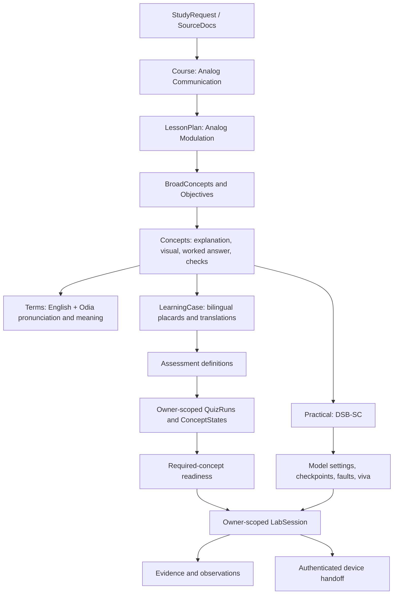

# Analog Communication → Analog Modulation → DSB-SC lab

This is the authored data package for the selected case, extending `lesson-ledger/v2`. It includes teaching content and domain contracts; it does not include a running backend, rendered illustrations, a Simulink `.slx` model, or a live pointer adapter.

**Start here:** [chapter ledger](ledgers/electronics/analog-modulation.json) for canonical content; [Odia learning case](cases/analog-modulation-odia.json) for bilingual presentation, assessments, lab configuration, and synthetic examples.

**Repository availability — 13 October 2026:** this documentation-only commit contains `ANALOG-MODULATION.md` and `ANALOG-MODULATION-PLAN.md`. The new JSON datasets, case types, helpers and validation tools described below remain local and uncommitted; their new-file links will not resolve in a clean checkout until that package is committed separately. Existing content types/subject-profile additions are also local. Validation results below describe the authored local package, not a fully published data release.

## What is prepared

| Item | Amount |
|---|---:|
| Broad concept groups / concepts | 4 / 10 |
| Exclusive objectives across the pyramid | 15 |
| Placards | 40: definition, concept, application, recap per concept |
| Glossary terms | 30: English, Odia pronunciation/meaning, bilingual example |
| Concept / separate chapter MCQs | 50 / 10 |
| Optional vocabulary / English / lab prediction checks | 10 / 10 / 7 |
| Worked questions and answers | 10, with Odia versions and concept-mark rubrics |
| Lab checkpoints / faults / viva prompts | 12 / 3 / 6 |
| Estimated chapter / lab time | 118 / 40 minutes; unvalidated estimates |

All 87 checks have an Odia prompt and feedback. Choice translations retain canonical option order; correctness uses the option index. English tasks are optional and separately assessed.

## Chapter and lab route

| ID | Group | Concept | Required for lab? |
|---|---|---|---|
| C-AM-01 | Foundations | Amplitude, frequency and phase | Yes |
| C-AM-02 | Foundations | Message, carrier and modulation purpose | Yes |
| C-AM-03 | Amplitude modulation | Conventional AM, envelope and modulation index | Yes: comparison with suppressed-carrier recovery |
| C-AM-04 | Amplitude modulation | DSB-SC generation and sidebands | Yes |
| C-AM-05 | Amplitude modulation | SSB/VSB and bandwidth comparison | No |
| C-AM-06 | Detection | Coherent demodulation and recovery gain | Yes |
| C-AM-07 | Detection | Lowpass filtering and waveform comparison | Yes |
| C-AM-08 | Detection | Carrier mismatch and debugging | Yes |
| C-AM-09 | Angle modulation | Frequency modulation and deviation | No |
| C-AM-10 | Angle modulation | Phase modulation and FM–PM distinction | No |

This is a curated core outline bounded by `REQ-AM-CURATED`, not a university syllabus. The course uses `kind: self` until real syllabus material is attached. Full power/noise analysis, complete FM/PM receivers, digital modulation, and advanced carrier-recovery loops are outside this package.

Lab route: **01 → 02 → 03 → 04 → 06 → 07 → 08**. Every required prerequisite is included. Preparation is open anytime; execution needs passed checks for only these seven concepts.

## Record relationships



Questions reference canonical checks, without duplicating answer keys. Each term has one introducing concept; dependent concepts borrow its id. `practicalId` joins the lesson, configuration, and session; `checkpointId` joins a step and its evidence.

## Progression and language

- Concept checks: **60%**, including 3/5. Revisit below this.
- Chapter test: **80%**, including 8/10. One separate question covers each concept.
- Attempt percentages measure correctness, not complete understanding. `theoryCheck` is separate from overall mastery.
- **Concept = green; words = red; English = yellow; practical = blue.** MCQs do not populate other dimensions.
- Account-first onboarding stores self-rated language comfort separately from assessment evidence.
- Canonical English and full Odia versions are authored. Default placards preserve English terms with Odia-script pronunciation and meaning.
- Localization metadata covers the two Odia support levels. Separately worded intermediate dial variants, recorded audio, and finished visual assets are not claimed.
- The initial bank has five practice questions per concept. Retrying prefers reviewed equivalent unseen items when available; a future generation/review path must supply fresh equivalents after this bank is exhausted. Do not reuse chapter questions as retries.

## Tracking and pointer

The **top-right Lab mode icon** opens the tracker: selected experiment, readiness, current/pending/completed checkpoints, observations, connection state, and saved revision.

Activation requires **experiment selected → required concepts passed → software opened → workspace confirmed → observation enabled/connection active → session active**. Entry alone, connecting, pause, disconnect, and completion leave the pointer inactive.

Semantic targets are resolved against the actual current workspace, without invented pixel coordinates. The student performs every placement, connection, parameter change, run, and correction.

The 12 checkpoints cover workspace, source placement/settings, transmitter, receiver, filter/gain, scopes, simulation settings, baseline run, waveform comparison, phase fault, and restoration/save/explanation. Each includes an Odia/English instruction, reason, expected evidence, and dependencies.

## Simulator model

| Parameter | Baseline |
|---|---|
| Message | Amplitude 1, 100 Hz, bias 0, phase 0 |
| Transmitter / receiver carriers | Amplitude 1, 2000 Hz, bias 0, Sine Wave phase pi/2 |
| Frequency field | `2*pi*f` rad/s in time-based continuous Sine Wave blocks |
| Lowpass | Second-order Butterworth, 500 Hz, continuous `Transfer Fcn` |
| Recovery gain | 2 for unit carriers |
| Simulation | `ode45`, stop 0.1 s, maximum step 1e-5 s |
| Ideal sidebands | 1900 and 2100 Hz |
| Predicted message-band recovery | Approximately 0.9992 amplitude, 100 Hz, about 16.4° filter phase lag |

Block inventory, connections, numerical coefficients, and proposed parameter strings are included. Mathematical predictions were checked; live browser application/display remain to be tested.

The main fault changes receiver phase from **pi/2 to pi**, a **relative 90° error**. The ideal message-band component vanishes; finite-filter residuals can remain. Other faults change receiver frequency to 2010 Hz or filter cutoff to 50 Hz. Students correct and explain the outcome.

## Learner records and handoff

`seeds` are explicitly **synthetic**, never evidence of a real learner or integration. They include language onboarding, curated intake, concept attempts/retry, theory states, independent chapter boundary-score examples, phone/laptop session snapshots, and authenticated handoff.

Only reviewed/integration-verified evidence counts as a verified checkpoint. Student checkboxes remain self-report. An active fixture does not prove the actual adapter works.

Handoff paths locate sessions; they do not grant access. The backend authenticates the visitor, verifies ownership, and transfers control to one device while the old device can observe. Expired/stale/unsynced handoffs fail. Workspace confirmation and observation permission reset on the destination.

If software was already opened, save the external model and project reference before transfer. Phone preparation needs no already-created model. Kiki cannot recreate an unsaved external model from session state.

## Storage boundaries

Retain existing content collections: `courses`, `subjectProfiles`, `lessonPlans`, `broadConcepts`, `concepts`, `objectives`, `terms`, `practicals`. Add static `learningCases/{caseId}` and referenced `assessmentDefinitions/{id}` or subdocuments.

Keep personal data under `learners/{id}/quizRuns`, `conceptStates`, and `labSessions`; evidence/observations can be session subcollections. Uploaded and captured media use owner-scoped asset references. Handoffs are owner-scoped, expiring, server-processed records.

Never import `seeds` into public content. Replace demo learner/device/project ids for real sessions. Construct the server actor from verified authentication, validate incoming payloads, and persist revision transitions atomically. Included runtime functions implement pure policy, not the database/authentication/screen adapters.

## Files and verification

| File | Responsibility |
|---|---|
| `types/learning-case.ts` | Bilingual content, assessments, checkpoints, evidence, sessions, handoff |
| `ledgers/electronics/analog-modulation.json` | Existing v2-compatible chapter |
| `cases/analog-modulation-odia.json` | Bilingual content, policies, model specification, synthetic fixtures |
| `runtime/learning-case.js` | Pure scoring, readiness, activation, evidence filtering, handoff |
| `validate-case.js` | References, coverage, policies and fixtures |
| `tools/test-learning-case.js` | Boundary, isolation, activation, handoff, numerical tests |
| `tools/typecheck-learning-case.js` | Strict literal-data type checking using temporary files |

Run from the repository root:

```sh
node data-model/validate.js data-model/ledgers
node data-model/validate-case.js
node data-model/tools/test-validator.js
node --test data-model/tools/test-learning-case.js
npm exec --yes --package=typescript@5.9.3 -- node data-model/tools/typecheck-learning-case.js
```

TypeScript runs in a temporary tool environment without adding a repository dependency or generated source files.

**Python backend:** the backend language is Python, confirmed on 13 October. The JSON content/IDs/policies remain portable. Treat TypeScript types and JavaScript policy helpers as reference contracts; implement Python validation/scoring/session policy and verify them against the same JSON cases. The web UI remains React/TypeScript. This documentation commit does not include that Python implementation.

## Review and next step

Canonical content, questions, Odia copy/transliterations, and visual briefs remain **drafts**. Instructor/native-language review, illustration rendering, and the real model/pointer trial remain before student release. Structural/type/numerical checks do not replace these reviews. No uploaded syllabus/manual, past papers, university semester, Gemini self-check or successful live integration was invented.

Primary references: [modulation methods](https://www.mathworks.com/help/comm/ug/analog-passband-modulation.html), [coherent receiver](https://www.mathworks.com/help/comm/ref/dsbscamdemodulatorpassband.html), [Sine Wave units](https://www.mathworks.com/help/simulink/slref/sinewave.html), [Transfer Fcn](https://www.mathworks.com/help/simulink/slref/transferfcn.html). They are attached as `SourceRef.url` entries. Lesson/question wording is original teaching copy.

**Next:** instructor and Odia review, followed by the specified Simulink model/checkpoint trial before UI integration.
