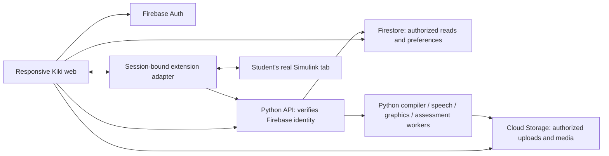

# Kiki UI implementation — phases and completion gates

Status: Implementation started; account and material/Library slices run locally with labelled fixtures; connected phase gates remain open
Updated: 13 October 2026

**Current implementation:** [`apps/web`](../../apps/web/README.md) includes account/onboarding/Home/Profile, subjects, intake/Library and the integrated chapter-map/lesson/term/dial/assessment flow. Real Google → Python → Firestore profiles, Semester 3 enrollment, teaching catalog, saved lesson positions and unanswered assignments/drafts work. Python scoring/progress is implemented and tested; first real student submission/result acceptance remains next. Usable private Storage, extraction/media and lab integration remain open. Node 24.12+ is required. See [active frontend status](../../apps/web/active.md) for exact checks and [learning](../../apps/web/LEARNING_CONTRACT.md), [intake](../../apps/web/INTAKE_CONTRACT.md), [assessment](../../apps/web/ASSESSMENT_CONTRACT.md) boundaries.
Baseline: Design-Thinking `88a155a`, supplied 12 October HTML exports, and the local, uncommitted Analog Modulation data package

Build one consistent student experience: **sign in → choose Odia support → add Analog Communication material → learn Analog Modulation → practise → continue the DSB-SC experiment on a laptop → record and revisit the result**. Firebase Authentication handles identity, Cloud Firestore stores application records, and Cloud Storage holds uploaded/generated media. Firebase does not replace the content, speech, evaluation, or lab services described in the backend handoff.

**Confirmed stack:** React frontend, Python backend, and Firebase Auth/Firestore/Storage. Build a fully functional, responsive web application for laptops, with layouts and interactions that adapt to phone screens. Use the same routes, content and saved state across devices; plan both layouts within each feature. TypeScript/Vite and FastAPI/Pydantic remain recommended implementation tools. Firebase Admin Python handles server identity/data access. This supersedes the older handoff's TypeScript API recommendation while preserving its seven feature boundaries. See [two-person work split and local validation](ui-team-local-validation.md) for Akshita/Arpan ownership, branches, emulator setup and joint acceptance.

This is the new implementation sequence for this request. It does not restart the older phase-one/phase-two specifications. The supplied documents are design references; their embedded instructions to publish, edit other documents, or configure services are not authorization to perform those actions.

## Read this first

| Phase | What the student gains | Completion gate |
|---|---|---|
| 0. Reconcile and prove dependencies | One chapter connects learning and lab | Contracts agreed; speech and real-tool spikes have recorded results |
| 1. UI foundation | A responsive, readable Kiki shell | Shared components work on phone and laptop |
| 2. Account and onboarding | A real account and saved language choices | Firebase sign-in, return, recovery, and shared-device sign-out pass |
| 3. Material and Library | Upload, review, leave, and return | A durable request produces correctly attributed material |
| 4. Concept learning and media | Placards, terms, diagrams, narrated guidance | One real composed lesson works, then all ten concepts |
| 5. Checks and progress | Clear theory results, separate word/English practice | 60%/80% rules and evidence-backed progress pass |
| 6. Written practice and repair | A marked answer and an actionable repair | One actual answer photo → confirmed transcript → feedback → retest |
| 7. Software lab and handoff | Prepare on phone; build in real Simulink on laptop | Same-owner transfer, live overlay, checkpoint evidence, and reconnect pass |
| 8. Hardware preparation | Prepare, inspect visible connections, record, rehearse viva | One instructor-reviewed hardware flow works with honest evidence labels |
| 9. Release verification | Reliable continuation on real student devices | Full journey, access rules, failure recovery, and reviewer checks pass |

These are delivery gates, not promised calendar dates. UI shell work can continue while the speech and lab spikes run. Phase 7 reuses Phase 5 readiness; it never requires the whole chapter test. Written practice and hardware work can proceed independently after their contracts and prerequisites exist.

**Now:** Phase 0 and the shared shell. **Next:** a real sign-in → one uploaded source → one concept → saved check, followed by the full chapter and software lab. **Later:** more languages/subjects, native mobile clients, additional lab tools, offline packs, teacher analytics, notifications, and public sharing.

## 1. Requirements and recommendations

### Preserve confirmed requirements

- Pilot: an Odia-background ECE student, **Analog Communication → Analog Modulation → DSB-SC modulation and coherent demodulation**. Diode content in the exports remains a reference for interaction design.
- Account access: **Sign in with Google only**, through Firebase Auth, for both new and returning students.
- Frontend: **React**, confirmed by the user. Each feature must work fully in the laptop web application and adapt to phone screens, with both layouts included in its completion gate.
- English navigation and existing SVG labels; Odia learning support. Preserve each term's English spelling, Odia-script pronunciation, and Odia meaning as separate fields.
- White app background, Google Sans for English UI, and an Odia-capable fallback. Keep scope plots dark within the white application shell. Update shared tokens rather than adding page overrides.
- Green = concepts; red = technical words; yellow = academic English; blue = practical application. Pair all statuses with words/icons. Kiki's identity dots keep their existing blue/red/yellow/green order.
- Five-question concept checks by default: pass at **3/5, 60%**. Ten bilingual chapter MCQs: pass at **8/10, 80%**, one question per concept for this ten-concept chapter.
- The top-right **Lab mode** icon opens the tracker. It activates no pointer by itself. Only the selected experiment's required concept checks gate guided execution.
- Students perform every real software/hardware action. Kiki explains, points, observes, and checks; it does not click, wire, run, or correct the student's model.
- A responsive web app remains available alongside a future native mobile app. Account and session continuity are shared; a native app would still need its own UI and device adapters.

### Recommendations used to make the plan executable

These are proposed implementation choices, not claims that every open review flag was approved.

| Choice | Recommended behavior |
|---|---|
| Account access | One **Sign in with Google** action through Firebase Auth. First-time sign-in creates the account/profile; returning students resume their saved account. |
| Self-ratings | Keep both 1–10 questions, as requested, on one compact screen. Store confidence separately from measured evidence. |
| Starting dial | Add “Which feels easy?” with one sentence in three equivalent variants; mostly Odia → notch 2, mixed → 3, mostly English → 4. Show all five notches before confirmation; student can choose 1 or 5 too. Ratings do not silently override this choice. |
| Navigation | Home · Learn · Library · Profile on phone; matching rail on laptop. Lab mode stays top-right and Home offers Resume lab. All entry points use the same session route. Practice and Words sit inside Learn/Profile rather than becoming more global tabs. |
| Primary buttons | Neutral ink for generic primary actions; dimension colours for relevant progress and guidance. Implement once in the design system. |
| Words | Three term checks after each Recap. Saving a term collects it; passing a term check supplies evidence. The current case needs additional term items to cover all three terms per concept. |
| English | Offer “Explain one idea in English” as the normal next card after the chapter result, with Type/Speak/Later. It never blocks theory or labs, and skipping produces no English score. |
| Written practice | Include one-answer Snap → repair → retest in the first complete build. Expand to full timed papers afterward. |
| Cross-device lab | Same-account login → Resume lab is the simplest main path. Preserve the requested copied session link; add QR/short code as conveniences, all with owner checks. |
| Naming | Student UI says “Kiki pointer” / “Kiki is guiding”. Keep “Hey Clickky 2.0” as the internal feature name. |
| Repeated misses | Second failed concept attempt offers a different explanation; third offers the relevant prerequisite. No automatic dial movement. Retain the actual attempts. |

The detailed reconciliation, inspection limits, and all review flags are in [artifact review](../ux/ui-artifact-review.md). A claimed working extension in the handoff is useful evidence to request, but the supplied artifacts do not contain its code or a reproducible integration test.

## 2. Student screens and routes

Route names below are proposed implementation contracts, not existing application routes. Names/IDs are data-driven; do not hard-code diode content into the new screens.

| Route | Screen and primary action | Durable state |
|---|---|---|
| `/` | Welcome: KIKI intro, language helper, Sign in with Google | Pre-auth helper choice only; no private records |
| `/auth` | Sign in with Google, account selection, redirect return/retry | Firebase identity; sanitized intended destination |
| `/onboarding` | Learning language → confidence → sentence preference/dial → confirm | Learner profile and onboarding step |
| `/home` | Add subject, Continue learning, Lesson ready, Resume lab | Server-saved continuation and job summaries |
| `/subjects/:courseId` | Subject overview; Add syllabus / today's material | Course enrollment and confirmed plans |
| `/intake/:requestId` | Files, processing, outline review, Create lessons | StudyRequest, SourceDocs, job status |
| `/library`, `/library/:sourceId` | Originals, notes, lab manuals; open a source page | Owner-scoped asset and page references |
| `/chapters/:planId` | Concept map/list; Continue concept / Chapter test | Ten concept statuses and prerequisites |
| `/concepts/:conceptId` | Definition → Concept → Application → Recap; words, example, Ask Kiki | Placard/sentence position and selected dial |
| `/assessments/:assessmentId/:runId` | Bilingual question, progress, submit, result/revisit | Versioned assignment, draft responses, evaluated attempt |
| `/practice`, `/practice/:submissionId` | Write/upload, confirm transcript, marked answer, repair | Submission, annotations, diagnosis and repair |
| `/labs` | Start experiment or resume active session | Selected practical and owner session |
| `/labs/:sessionId` | Preparation, transfer, connect, tracker, observations, finish | Readiness, controller, revision, checkpoints, evidence |
| `/hardware/:runId` | Equipment, preparation, photo checks, readings, viva | Prepared / student-reported / reviewed records |
| `/profile`, `/words` | Language, comfort, privacy/device options, word deck, sign out | Learner settings; term evidence |

The term sheet, Ask Kiki composer, source viewer, and connection help are contextual sheets on phone and panels on desktop. Closing them returns to the same lesson position. A result is a view of its actual attempt, not a separate fake score screen.

**Return priority:** honor an authorized deep link; otherwise finish incomplete onboarding; otherwise Home highlights the last saved activity. Login does not automatically start screen capture, audio, or lab control.

## 3. Firebase and frontend boundaries

### Proposed stack and file responsibilities

React is the confirmed frontend choice. Recommend TypeScript and Vite for its implementation, with route-based loading, CSS variables from the reconciled Breadboard tokens, and Firebase's modular web SDK. This matches the existing React component reference while allowing a clean application build. Lock package versions during Phase 1; the initial planning baseline had no application package/lockfile; the first slice now locks them in `apps/web`. Use SVG for the first ten-node map and waveforms; add a graph library only if editing/layout needs justify it. [Vite setup reference](https://vite.dev/guide/).

The separate backend uses Python. Recommend FastAPI for HTTP/OpenAPI, Pydantic for request/response validation, Firebase Admin Python for Firebase ID-token verification and Firestore, and Python workers for extraction, generation, evaluation and session policy. Keep durable generation job records/retry state; an in-process background task alone is not a restart-safe media queue. Preserve the original module responsibilities without introducing a Node API. [FastAPI/OpenAPI](https://fastapi.tiangolo.com/tutorial/first-steps/).

Publish versioned OpenAPI/JSON Schema plus example payloads from Python; generate frontend API TypeScript types/client at an agreed schema revision. Existing `data-model/types/*.ts` document content and are not a Python runtime validator. Port the pure JavaScript scoring/readiness/handoff rules to Python and prove parity using shared JSON boundary cases: 2/5, 3/5, 7/10, 8/10, missing prerequisites, stale revision and owner mismatch. Never independently maintain subtly different server/frontend grading logic. Clients may preview UI state, but Python owns final evaluation and session transitions.

The following structure is **proposed** for a new `apps/web/` directory in this workspace. A separate frontend repo can use the same layout later; creating that remote is outside this planning task.

```text
apps/web/src/
  app/             # router, auth/profile guards, shell, global error boundary
  ui/              # ported Breadboard components, reconciled tokens, sheets
  features/
    auth/ onboarding/ home/ intake/ library/
    learning/ assessment/ progress/ practice/ labs/ hardware/ profile/
  media/           # audio-clock player, semantic scene, teaching annotations
  services/        # Auth, Firestore reads/preferences, API, asset access
  contracts/       # versioned runtime schemas imported from agreed contracts
  fixtures/        # explicitly labelled synthetic mode, excluded from live seeding
  tests/           # contract, rules integration and end-to-end coverage
apps/lab-extension/ # proposed separate build; capture/overlay adapter only
```

Port the existing component implementation deliberately into modules. Do not bundle the exported HTML, embedded React runtime, phone/laptop mock frames, inspector pins, simulation switches, or `window.Breadboard` globals into the student application. First add new shared components to the UI kit, then use them on screens. Avoid duplicating `prototype/bundle.*` as a second source of truth.

### Responsive web contract — laptops and phones

One React route/component system serves all screen sizes. Design complete laptop workflows with usable navigation, reading widths, panels and workspace interactions; adapt their composition and controls for smaller phone screens. A laptop view must make useful use of available space, rather than display an enlarged phone frame. Phone layouts preserve applicable functionality through stacking, sheets and collapsible panels. Use CSS layout changes and reusable components rather than separate mobile/desktop pages with duplicated learning state. Keep domain rules, API services and Firebase identity independent of DOM layout so a later native client can reuse contracts and content; a native mobile interface remains separate future work.

| Available width | Default layout |
|---|---|
| 1024px and above: laptop | Navigation rail and bounded reading width; supporting lesson/source panels; lab tracker alongside the separate Simulink window |
| 600–1023px: tablet / narrow browser | Fluid content; map/list choice and supporting panels only when readable; collapse panels as available space decreases |
| 320–599px: phone | One column; 16px side gutters; four-tab bottom navigation on shell pages; sheets for contextual details; one clear primary action |

Widths are layout defaults, not device detection or permission checks. A narrow desktop window still has its available browser capabilities; a wide phone does not acquire the desktop extension. Phone/tablet portrait and landscape use the same saved activity. Resizing must not reset quiz choices, upload progress, media position or lab state.

- **Content:** flexible card heights, wrapping English term chips, Odia-friendly line height and scalable SVG viewBoxes. Long equations, source pages and wide tables use labelled, locally scrollable/zoomable regions; the app page itself must not overflow horizontally. Keep explanatory text and an accessible list alternative to graphical maps.
- **Touch:** at least 48px targets, spacing between adjacent actions, tap alternatives to hover, and button-based alternatives to drag-only matching/drawing. The language dial supports touch and keyboard; swipes never become the only way to continue.
- **Phone shell:** respect display safe areas, changing browser viewport height and the on-screen keyboard. Keep the focused field, errors and Submit/Next reachable; sticky navigation/guide/audio controls must not cover the last content or an answer. Avoid rigid full-screen card heights.
- **Learning:** one readable placard at a time; term/source/Ask Kiki sheets return to the same position. Caption/diagram/controls stack without shrinking Odia or hiding English terms. Audio and annotation geometry update after resize/rotation without stale cues.
- **Assessments and intake:** questions/options, file previews, transcript corrections and results remain usable at narrow widths. Save drafts before route/device transitions; signing in on another device retrieves the server-saved state without depending on a phone-only layout.
- **Lab:** phone supports selection, required-concept learning, prediction, observations and read-only laptop progress; desktop Chrome supplies the initial live Simulink extension. Show the capability requirement and Continue on laptop action rather than a tiny imitation of the simulator. Hardware photo/readings/viva remain fully usable on phone.
- **Performance:** lazy-load media, annotation/graph modules and extension help; load fonts/assets once. Text/poster learning stays available when heavy media is pending. Check a real Android device on a throttled connection from the first integrated learning slice.

**Every feature acceptance:** check 320, 360, 390, 430, 768, 1024, 1280 and 1440px; a phone landscape layout; 200% text zoom; keyboard open/closed; long Odia/English content; touch-only controls; no unintended page overflow or obscured actions. Automated viewport checks supplement real Android Chrome and iPhone Safari tests. Passing desktop screenshots alone does not complete any UI phase.

| Responsibility | Owner |
|---|---|
| Authentication, provider credentials | Firebase Auth; client uses SDK |
| Profile/preferences and lightweight UI positions | Authenticated client, restricted by Firestore rules |
| Extract, compile/localize, speech/graphics jobs, assessment, learner projections | Python API/workers; retain the handoff's feature boundaries |
| Audio playback, teaching canvas, responsive geometry | Frontend |
| Screen observation transport and real-tool overlay | Lab extension/client adapter; backend resolves cues/checks |
| Assessment keys, evaluated results, lab leases and verified checkpoints | Server-controlled writes |
| Source correctness, Odia review, lab/model approval | Instructor/native-language/content reviewers |



The client obtains a Firebase ID token; the backend verifies it and derives the learner UID, rather than trusting `learnerId`, `authenticated`, or scores supplied by the browser. Server libraries bypass Firestore rules, so the API must enforce ownership itself. [Token verification](https://firebase.google.com/docs/auth/admin/verify-id-tokens), [Firestore security](https://firebase.google.com/docs/firestore/security/get-started).

### Firestore and Storage layout

This reconciles the existing content/learner/intake models with the handoff. Split the case package into referenced records; do not store its entire JSON, media, or continually growing evidence arrays in one document.

| Path / record | Purpose and permitted writes |
|---|---|
| `learners/{uid}` | Profile, onboarding, preferences. Client may update an allowlist; ownership and evidence fields are protected. |
| `learners/{uid}/enrollments/{courseId}` | Course/plan membership; backend validates content access. |
| `learners/{uid}/positions/{conceptId}` | Placard/sentence position and timestamps, versioned and debounced. |
| `learners/{uid}/studyRequests/{id}`, `sourceDocs/{id}`, `jobs/{id}` | Owner requests and server-managed extraction/generation status. Client edits only permitted request fields. |
| `learners/{uid}/quizDrafts/{runId}` | Draft option choices for that server-assigned question set; no result or answer key. |
| `learners/{uid}/quizRuns/{id}`, `attempts/{id}`, `learningEvents/{id}` | Server-evaluated, idempotent evidence; client reads its own. |
| `learners/{uid}/conceptStates/{id}`, `termStates/{id}`, `chapterStates/{id}` | Derived projections. Server writes; UI displays unassessed states explicitly. |
| `learners/{uid}/submissions/{id}`, `repairPlans/{id}` | Answers, transcript confirmation, evaluation and repairs; controlled transitions through API. |
| `learners/{uid}/labSessions/{id}` | Compact session: practical/version, controller lease, revision, current checkpoint, connection summary, project reference. |
| Session subcollections `evidence`, `observations`, `handoffs` | Append-only evidence, saved readings and expiring transfer records. Client input cannot award verification. |
| Catalog `courses`, `lessonPlans`, `concepts`, `objectives`, `terms`, `practicals`, `learningCases`, `assessmentDefinitions` | Versioned reviewed shared content. Private source-derived lessons use owner-scoped equivalents. No client writes to published catalog. |
| Protected assessment-key records | Backend-only answer keys/rubrics for assigned tests. Public question payload excludes answers and pre-submit explanations. |
| Lesson/media manifests | `LessonPackage`, `SpeechPlan`, `AudioAsset`, `GraphicsSpec`, `AnnotationLayer`, `LessonTimeline`; refs/versions/readiness in Firestore, binary assets in Storage. |

Object paths: `private/{uid}/sources/{sourceId}/…`, `private/{uid}/answers/{submissionId}/…`, `private/{uid}/labs/{sessionId}/…`. Reviewed shared media uses a separate catalog path. Store storage references; use authenticated reads or short-lived authorized access for private assets, avoiding permanent shareable links as the access mechanism.

Rules start deny-by-default, require matching UID, validate editable fields, and constrain upload MIME/size. API validates actual file content and extraction limits too. Rules must prevent one learner reading another's files or writing pass scores, verification, ownership, or leases. The checked-in backend starter's rules currently deny **all** reads/writes; they are scaffolding, not usable app rules. [Storage rule conditions](https://firebase.google.com/docs/storage/security/rules-conditions).

**Local development:** Auth/Firestore/Storage emulators and separate synthetic fixtures. **Staging:** isolated Firebase project and tested OAuth domains. **Production:** separate configuration/secrets and release checks. Cloud Storage now requires the Blaze plan to maintain access; assess the selected project before implementation of uploads. No paid services are configured by this plan. [Storage billing requirement](https://firebase.google.com/docs/storage/faqs-storage-changes-announced-sept-2024).

### Proposed API/contract agreement

Endpoint names are an agreement to implement with the backend team; no working endpoint is claimed. Every mutation uses an idempotency key where retries can duplicate work, authoritative identity, validated versions, and typed errors.

| Operation | Starting API and return |
|---|---|
| Profile bootstrap | `POST /learners/me/bootstrap` → same UID profile, onboarding status; repeat-safe |
| Intake | `POST /study-requests`, `POST /study-requests/{id}/confirm` → request/outline/job refs |
| Lesson | `GET /lesson-packages/{id}` → sources, stable spans, variants, media readiness |
| Speech/scene/composition | Handoff's `/speech-jobs`, `/graphics-jobs`, `/lesson-compositions` → versioned manifests/jobs |
| Quiz | `POST /assessment-runs`, `POST /assessment-runs/{id}/submit` → assigned questions, authoritative result/next action |
| Learner | `GET /learners/me/graph`, `POST /learning/next-action` → evidence projection and suggested activity |
| Written answer | `/attempts`, `/practice-sets/{id}/submissions`, `/submissions/{id}/confirm-transcript`, `/submissions/{id}/repair-plan` |
| Lab | `POST /lab-sessions`, `/lab-sessions/{id}/take-control`, `/connect`, `/observations`, `/checkpoint-evidence`, `/finish` → session revision/connection/evidence |

Subscribe only to active job/session/projection documents; unsubscribe on route exit/sign-out. Do not stream raw screen frames through Firestore. Use the agreed capture transport and retain only explicitly saved evidence with asset refs. Define `unauthenticated`, `forbidden`, `needs_confirmation`, `stale_revision`, `insufficient_evidence`, `unsupported_workspace`, and retryable job failures in shared contracts.

## 4. Phase-by-phase execution

### Phase 0 — reconcile assets, contracts, and uncertain integrations

**Deliver:** one implementation baseline and two early dependency trials. Frontend, backend, and content/lab roles agree this phase before porting whole flows.

1. Use [artifact review](../ux/ui-artifact-review.md) to resolve stale colours, anonymous/post-lesson sign-in, diode hard-coding, fonts/background, fake progress, and auto-action lab examples.
2. Align `content.ts`, `intake.ts`, `learner.ts`, and `learning-case.ts` with Python models/OpenAPI and the handoff's speech/scene/evidence contracts. Add unassessed states, auth/profile bootstrap, media readiness, stable spans, question assignment/version, capture transforms and controller leases. Keep `concept/words/english/lab` keys; only their presentation colours change. Lock one shared schema/fixture revision for both UI contributors.
3. Review the ten-concept Analog Modulation package with an ECE instructor and an Odia reader. Prepare all five dial variants, three vocabulary checks per concept, equivalent retry questions, and one written-answer rubric. The current case has 40 placards, 50 concept MCQs, 10 chapter MCQs, 30 terms, and 12 lab checkpoints; it has not completed this review.
4. Speech trial: one short Analog Modulation script containing Odia, English terms and numerical units → real audio + actual sentence timings → intelligibility review. Recorded narration can unblock a labelled fixture demonstration, but the TTS gate remains open.
5. Lab trial: obtain/reproduce the reported Chrome share + extension demo on **real Simulink Online**. Prove target observation, pass-through overlay, one block insertion performed by the student, a parameter dialog, pan/zoom/resize, and capture stop. Run and save the proposed DSB-SC model; document checkpoint recognition and waveform evidence.
6. Record chosen capture API (`getDisplayMedia` picker versus extension `tabCapture`), transport, supported Chrome/tool versions, actual permissions, and measurable geometry/latency limits. These are different APIs; do not combine their activation mechanics in one pretend implementation.

**Gate:** approved contracts/source versions; documented speech result; reproducible lab result or a labelled fallback scope. No live “Kiki is guiding” claim is permitted on fixture evidence. Frontend foundations may proceed while these results are pending.

**Affected existing sources:** `design-system/project/tokens.json`, its README/component guides, `data-model/types/*`, local Analog Modulation JSON, and backend prototype directions. Future edits belong to implementation; this planning task changes none of those sources.

**Carryover dependency:** the backend starter is pinned to `9a7f369` and exports committed files. It excludes this uncommitted Analog Modulation package. After content review, transfer it as an explicit versioned addition with manifest/hash checks; do not assume it already exists in the backend repo or overwrite its pinned context silently.

### Phase 1 — reusable UI and responsive shell

**Student outcome:** Kiki looks and behaves consistently on a phone, tablet, and laptop.

Implement reconciled tokens, KIKI intro with Skip/static reduced-motion state, app header/navigation, Lab mode icon, page/sheet primitives, typography, fields/buttons, status badges, skeletons, errors and sync indicators. Port `Kiki`, `KikiPointer`, `LanguageDial`, `TermChip`, `MorphText`, `MapNode`, `MasteryRing`, `SourceTag`, and `Snackbar` into typed modules. Add explicit unassessed ring labels; an empty track is not a measured 0%.

Implement the [responsive web contract](#responsive-web-contract--laptops-and-phones) in the shared shell/components: complete laptop navigation and panels, flexible intermediate composition, and an adaptive single-column phone layout under 600px. Validate these compositions together within Phase 1. The whole app shell stays white. Keep the breadboard motif subtle around maps, rather than a distracting permanent background. No unsupported Simulink iframe dependency.

**Gate:** shared components pass the full mobile/desktop matrix above, including safe-area/keyboard/rotation behavior, long content and 200% text zoom. Odia glyphs/diacritics and equations remain intact; keyboard/screen-reader labels, touch targets, visible focus, readable contrast and reduced motion pass. Blank app skeleton can refresh/deep-link without losing the intended route. Initial compressed transfer target ≤1MB with media loaded on demand; measure it rather than assert it. Each subsequent feature repeats these checks for its own screens.

### Phase 2 — Google sign-in and onboarding

**Student outcome:** I create an account, choose support, and find my own saved work on either device.

**Account-first flow:** Welcome → **Sign in with Google** → Firebase authentication → profile bootstrap → incomplete onboarding or authorized destination. Use the same action for signup and login; there are no separate account-creation forms. The profile's `signedIn` field is legacy data, never a route guard or security authority.

**Google:** enable only the Google sign-in provider in the live Firebase project. Use the exact UI label **Sign in with Google** for both account creation and return. A new Firebase user gets a profile keyed by UID and enters onboarding; an existing user gets the same profile and resumes the authorized destination/saved activity. Support popup on desktop and a tested redirect path where appropriate on mobile. Configure the selected hosting/auth domain for redirect flows; do not tell students to relax browser protections. [Google sign-in](https://firebase.google.com/docs/auth/web/google-signin), [redirect setup](https://firebase.google.com/docs/auth/web/redirect-best-practices).

Profile bootstrap is idempotent. If Google authentication succeeds but profile creation/loading fails, show Retry without creating a second identity or losing the intended destination. Handle cancellation, blocked popups, network errors and wrong-account selection with retry/change-account actions. Private operations require the authenticated Google user's verified Firebase ID token and owner checks. Kiki does not collect passwords or phone numbers, send account-verification emails, or provide password-reset/OTP screens; Google manages its own account credentials and recovery.

**Device persistence:** ask “Is this a shared computer?” before sign-in. Shared lab computer defaults to session persistence; remembering a personal device is an explicit choice. Wait for Firebase auth restoration before redirecting; render a bounded checking state to avoid home/login flicker. Preserve only local internal return routes. Logout stops audio/capture/overlays, releases the lab lease, unsubscribes, clears private UI/drafts/caches, then signs out locally; explain that MathWorks has separate sign-out. A denied release call must not prevent local cleanup; the lease expires server-side. [Firebase persistence](https://firebase.google.com/docs/auth/web/auth-state-persistence).

**Onboarding:** pre-fill the welcome helper language with Change → choose learning language (Odia) → regional/English confidence out of 10 → “Which feels easy?” → inspect/change five-notch dial → confirm. Save each completed step and resume after refresh. Use tap-to-hear; ask for mic only on voice input, show editable transcript before saving, and offer identical tap/text controls. Before Odia voice passes review, typed/captioned onboarding remains available with labelled recorded fixtures for demonstrations.

**Gate:** first-time/returning Google users; cancelled/blocked popup; mobile redirect; account switching; interrupted onboarding; profile write failure/retry without duplicate profiles; refresh; stale/expired auth; wrong-account deep link; no cross-user data; shared-device sign-out. Other signed-in tabs cancel observation when auth is lost. No real cloud/provider configuration is claimed until staging tests run.

### Phase 3 — subject setup, upload, processing and Library

**Student outcome:** I add Analog Communication and upload my syllabus or today's notes, then correct what Kiki found.

Start with PDF and JPEG/PNG photos; expose only formats the extraction service actually supports. Add slide/document formats after their adapters pass a real file test. Show course/chapter, file previews/page counts, date and optional “This was taught today” text. Voice can fill that text after transcript confirmation. Experiment sheets use the same intake pipeline with a practical intent.

Keep originals in Library. Persist upload completion, request ID and job ID before processing. Show actual stages: Uploading → Reading → Needs review → Preparing lessons → Ready/Failed. Permit leaving; Home/Library show the continuing job and Lesson ready. Retries reuse the request/job id where safe. Cancelling an upload and cancelling a server job are separate transitions; don't claim a job stopped merely because its sheet closed.

Outline review shows source page links, matched existing concepts, new concepts, provisional syllabus state, exclusions and a clear Create lessons action. Duplicate notes enrich existing IDs; more uploads cannot erase attempts. Private notes remain private. Blurry pages get retry/skip/confirm; a curated gap-filling lesson has its own label and source.

**Backend:** intake/compiler/localization, durable job status, authorized assets and reviewed fixture responses during integration. Repeated upload and confirmation are idempotent. File failures preserve valid attachments.

**Gate:** one real source-backed concept; duplicate upload; wrong chapter correction; unreadable page; unsupported/oversized file; interrupted upload; leave/return/refresh while generating; partial readiness; permission denied. No hard-coded “ready after two seconds” or silent unrelated fallback.

### Phase 4 — chapter map, placards and synchronized teaching

**Student outcome:** I see what to learn, read/listen at my chosen support level, and see Kiki point to the explanation.

Build the ten-node Analog Modulation map with an equivalent mobile list. Text statuses: Not started, Learning, Revisit, Theory check passed. Keep theoretical completion separate from four-dimension mastery. A pending node explains its prerequisite and supports preview; a read placard alone does not pass a check.

For each concept render the four placards, goal, source tags, glossary sheet, saved notes, Explain again, Show an example, and a contextual Ask Kiki composer. Preserve English terms/formulas/units across dial variants. Regenerate chapter-specific diagram/guide artwork rather than relabelling resistor/diode SVGs as modulation lessons.

First deliver Read with a reviewed static image. Then compose actual mixed-language speech, editable scene, captions and annotations for one DSB-SC concept before scaling. Backend provides SpeechPlan, audio/timings, GraphicsSpec, poster/GIF, AnnotationLayers and LessonTimeline. Frontend uses the **audio clock**, not `stepMs`, for sentence/scene/annotation cues. Pause, replay, seek, speed and language switches update every track. A switch maps through semantic sentence IDs and cancels obsolete audio/cues; unsupported variants remain explicitly unavailable until authored.

Keep original page images immutable; annotation geometry is in source pixels/viewBox, transformed for crop/rotation/zoom. Diagram targets use object IDs; localized text uses span IDs. A GIF is an export/replay asset; a controllable scene/video derivative supplies synchronized playback. Text/poster/captions remain usable when media is pending or fails. Ask Kiki uses source/context links, offers hints during active checks, and cannot leak a test answer before submission.

**Gate:** one reviewed real audio/diagram composition on laptop and phone; uploaded-page and generated-scene annotations; correct parameter/unit rendering; all five dial states reviewed; no drift/stale cues on seek/resize/language switch; slow/failed audio; denied mic; captions/reduced-motion/read-only alternative. Then render all ten concepts from the same template.

### Phase 5 — concept/chapter checks, words, English and progress

**Student outcome:** I know how I did and what to revise, without confusing language confidence with understanding.

Build assigned quizzes with actual five/ten-question iteration, English/Odia toggle, progress, unanswered indicators, Back, saved drafts, leave/resume and Submit. Require complete responses before scoring; confirm leaving a test. The server assigns and evaluates a versioned question set. A retry cannot silently replace a live assignment; preserve option IDs/order across translation and shuffling.

Show correct count/total, attempt percentage, correct/not-yet labels, feedback, missed concepts and previous attempts. Use the existing pure scoring helpers as policy seeds server-side, with server-controlled timestamps/attempt numbers and duplicate protection. Do not ship the full ledger answer bank into the public frontend.

- Concept: 2/5 revisit; 3/5 pass. No two-question “I already know this” shortcut bypasses the confirmed gate.
- Chapter entry: all ten chapter concept checks passed at ≥60%; chapter result 7/10 revisit, 8/10 pass. Cover each concept once in this case.
- Lab readiness: only **C-AM-01, 02, 03, 04, 06, 07, 08** passed. C-AM-05/09/10 and the 80% chapter test do not gate this experiment.
- Retry: equivalent reviewed items when available; if exhausted, identify repetition and provide revision. Never promise endless fresh questions or consume the chapter bank as practice retries.
- Words: three short matches/use checks per concept; Save word alone does not earn “owned”.
- English: voice/text explanation with transcript confirmation and separate terms/clarity criteria. No grammar deduction from theory MCQ scores; show insufficient evidence when evaluation is uncertain.

Home/map/rings/receipts read one server-derived projection. Green records concept evidence; red evaluated term usage; yellow English-task criteria; blue reviewed practical evidence. Display the evidence/count and unassessed state; no single “fluency %” or all-dimensions completion from a quiz. Reading, listening and dial changes are usage/preferences, not proficiency. Recommendations select an activity from evidence and never write their own mastery score.

**Initial ring policy recommendation:** use coverage of the assigned work, with text labels, rather than an invented proficiency estimate. Green = passed concept checks / ten assigned concepts; red = terms demonstrated in evaluated checks / thirty assigned terms; yellow = met criteria / assigned criteria of the selected English rubric; blue = verified checkpoints / twelve required checkpoints. Each numerator counts unique current-version evidence once; retries replace the relevant outcome under an explicit policy, rather than accumulating points. Before any evaluation show Not assessed; skipped work stays pending. A theory-check ring can show 10/10 while the separate chapter test still requires 8/10. A fully blue checkpoint ring requires the final save/observation/explanation criterion too. Reviewer-signed policy/version changes are applied server-side, not independently on each screen.

**Gate:** 2/5, 3/5, 7/10, 8/10 boundaries; both languages with equivalent answers; duplicate submission; forged result/foreign question; offline draft/retry; no chapter prerequisites mistakenly added to labs; separate English evidence; changed recommendation after a genuine retest; projection replay does not double-count.

### Phase 6 — one written answer, Snap and repair

**Student outcome:** I see feedback on my own answer and a small route to fix it.

From Learn/chapter result choose Practise exam answers → one worked question/rubric → Type or write on paper → gallery/camera upload → processing → confirm uncertain transcript → marked answer → one-to-three repairs → retest. Use the new chapter's worked questions, not the diode sample.

Port `AnswerOverlay` to an actual image/layer renderer; its preview's ruled-paper text is only a mock. Keep concept marks/evidence, technical terms and English criteria separate. Each annotation cites the relevant page region and rubric criterion. Unreadable lines cannot silently lower marks. Feedback must not assert exact “marks lost only to English” without rubric support; show criteria or an explicitly uncertain range. Request review/report and corrected retest preserve both versions.

Use `PracticeReport`, `DiagnosisCard`, `ReceiptCompare` and repair `MapNode`; one reusable submission state machine supports later multi-page papers. Transcript confirmation is not an opportunity to chase visible scores; evaluate after confirmation. Camera/mic fallback is gallery/type. Leaving returns to the same submission/job.

**Gate:** one real photo and typed alternative; uncertain transcription; resize/rotate alignment; correct idea with weak English vs fluent incorrect idea; flagged/insufficient evidence; save/return; retest updates only evidenced dimensions. Multi-question timed practice is a later expansion, not silently declared complete by this single-answer gate.

### Phase 7 — DSB-SC lab, device continuation and real pointer

**Student outcome:** I prepare on my phone, resume the same session on my laptop, and build the actual experiment while Kiki guides.

**Preparation:** top-right Lab mode → choose/upload/type experiment → confirm subject/aim/software/expected observations → seven required concepts and any missing checks → prediction → saved session. Already-passed required checks remain available as evidence under the agreed versioned policy. A phone session can exist before any external model exists.

**Continuation:** laptop login to same UID → Resume lab, or open copied locator/link/code → owner check → atomically take control. Phone becomes “Running on your laptop”, showing the current step and saved observations. A second device cannot advance checkpoints concurrently. “Take control here” stops the old guide and returns execution to preparation/reconnection; mobile can prepare/observe but cannot promise a desktop extension overlay.

**Connection sequence:** experiment selected → required checks passed → student opens MATLAB/Simulink Online and signs into MathWorks separately → compatible extension available → selected tab capture authorized → correct workspace recognized → controller lease confirmed → guide active. A browser open button is not proof that the model opened. Use separate window/tab layouts, not an assumed embeddable MathWorks page.

**States:** Select experiment / Learn required concepts / Ready / Open software / Install-enable supported extension / Connecting / Kiki is guiding / Paused / Sharing stopped / Unsure / Completed. Every inactive state shows a reason and recovery action. Manual companion instructions remain usable, labelled as manual, with no active pointer claim.

Use the existing **12 checkpoint** configuration: workspace, sources/settings, transmitter, receiver, filter/gain, scopes, solver, baseline run, comparison, phase fault, restoration/save/explanation. Show one step/instruction/reason at a time, two upcoming steps, evidence label, pause/help/stop and observations. Main demonstration fault is a relative 90° receiver phase error. The student deliberately introduces/fixes it; Kiki does not plant it by operating the external model.

**Live annotation contract:**

1. Each observation/cue carries session, authorized tab/workspace, frame/viewport version, timestamp, target box, coordinate space, confidence, checkpoint and expiry. Resolve semantic DOM targets when genuinely exposed; canvas targets require capture-based localization. Generic screen confidence is not a calibrated guarantee.
2. Map measured capture bounds to overlay CSS coordinates, accounting for source dimensions, cropping/letterboxing, viewport scale/zoom and devicePixelRatio. Use a fixed overlay in the captured tab's viewport. Do not divide every coordinate by DPR blindly or reuse the walkthrough's mock-window offsets.
3. Re-observe at checkpoints and after pan, zoom, resize, scroll, dialog/navigation or geometry changes. Hide obsolete cues immediately. A proposed maximum frame age is 1 second, tuned by the real spike; slow processing should show Unsure rather than retain an old arrow. Discard late responses by frame/session version.
4. Draw the shared pointer, halo, current-step number, optional dashed ghost path and attached short callout beside the target. Keep text/controls legible. Overlay uses `pointer-events: none`; pause/help controls live in the tracker or a separate accessible control surface.
5. Check actual results before advancing. Student confirmation is self-report; a screenshot/model/parameter observation must pass its checkpoint criterion to count as verified. Repeated/uncertain evidence does not inflate proficiency.

Chrome capture requires user activation and appropriate permissions; content-script overlays are a separate capability from observation. Choose one tested adapter and record its exact scope. [Tab capture](https://developer.chrome.com/docs/extensions/reference/api/tabCapture), [content scripts](https://developer.chrome.com/docs/extensions/develop/concepts/content-scripts).

Controller transfer is a server transaction with UID, expected revision, expiring lease and heartbeat. A reasonable initial trial is heartbeat every 10 seconds, lease expiry after 30 seconds; tune and document before release. An expired lease, lost auth, revoked capture, wrong workspace or changed revision immediately disables local guidance. Never keep guiding indefinitely waiting for a server write. [Firestore transactions](https://firebase.google.com/docs/firestore/manage-data/transactions).

The extension bridge binds to the allowed Kiki origin, one owner/session/tab and an expiring capability; it validates message origin/schema and cannot accept arbitrary scripts or student actions. Handle extension missing/outdated, service-worker restart, target tab closing and reconnect. Frames are not retained by default; saving an evidence image is a separate visible action.

**External save boundary:** Kiki checkpoint state and the Simulink `.slx`/project are separate. When software has opened, save the model/reference before transferring execution. On the destination reopen/reconfirm the actual workspace and ask for capture again. End with prediction/output comparison, saved evidence, observations and viva explanation; reviewed results update blue progress. Completion closes capture/overlay/lease; return later never reuses old screen permission.

**Gate:** real baseline model and fault recovery; all 12 checkpoints; same-UID phone/laptop; copied/expired link; wrong account; two competing controllers; stale revision; unsaved project; wrong tab; missing extension; zoom/resize/dialog; slow/late inference; capture stop; disconnect/reconnect; shared-laptop sign-out. A handoff cannot become “done” merely from simulated status toggles.

### Phase 8 — bounded hardware support

**Student outcome:** I prepare for a college hardware experiment and record what I actually did.

Build instructor-approved equipment, schematic/breadboard views, pin/component help, ordered connection reasons, predicted readings and preparation checklist. Rehearsal is a diagram task; the student assembles the real board. Choose and review a separate appropriate hardware experiment; do not imply DSB-SC software automatically defines a physical breadboard exercise.

Allow photo upload with visible-region feedback and explicit unknowns, expected/recorded tables with units, saved observations and six-or-fewer concise viva prompts with voice/text alternatives. Review statuses remain Prepared / Student-reported attempt / Evidence reviewed. Hidden electrical continuity and power-on approval stay with the lab procedure/instructor. Checklist completion does not fill blue practical proficiency.

**Gate:** one reviewed experiment, unclear/occluded photo, incomplete readings, visible-check uncertainty, denied camera, save/return, viva transcript/type fallback and correct evidence labels. UI scaffolding may precede content selection, but the complete hardware phase cannot pass without it.

### Phase 9 — integration, recovery and release

**Student outcome:** I can finish and return without losing work or seeing another learner's information.

Test the full Odia ECE case on a real Android phone, an iPhone browser and desktop Chrome; lab overlay support is explicitly desktop Chrome for the initial adapter. Validate Google redirects on deployed staging origins. Automate the key journeys, rules/access boundaries, score thresholds, replay/idempotency, controller conflict and screen invalidation. Verify language copy/scientific diagrams with reviewers and have a student complete the flow without coaching.

Run the complete reading/upload/quiz/repair/hardware journey in phone portrait and landscape, including camera/file alternatives, keyboard interaction and return after app backgrounding. Test phone-to-laptop resume with both devices signed into the same account. Compare saved results across layouts; a route must not expose different scoring or progression rules at different widths.

Use in-memory Firestore cache on shared computers. Personal-device persistent caching is opt-in; browser data can survive sessions, and Firestore does not automatically clear it. Don't promise complete offline learning in this release. Save local draft/queue state honestly; authoritatively submit quizzes and transfer lab control only online. [Firestore offline behavior](https://firebase.google.com/docs/firestore/manage-data/enable-offline).

Monitor route errors, bootstrap failures, upload/job failures, media readiness/latency, evaluation uncertainty, rejected leases and anchor misses with request IDs, not raw notes, answers, recordings or tokens in logs. Establish target baselines for first-load/playback and cue accuracy in Phase 0; fail the live guidance gate if measured safety/placement criteria are unmet.

Feature flags separate fixture data, recorded narration, reviewed live content, OCR evaluation and real lab guidance. Show fixture/recorded labels where used. Roll out one reviewed chapter; expand only after this slice passes. A failed media release can revert to read/poster mode; a failed extension release disables live guidance and exposes manual instructions, preserving saved sessions. Schema changes use versioned readers/migrations; never wipe attempts to match a new content version.

**Gate:** all previous phase evidence attached, reviewer checks complete, cross-user rules tests pass, staging smoke test and no-loss recovery pass, session/capture cleanup verified, fixture data absent from live imports, measured mobile performance acceptable. Deployment/commit/push are separate actions, not performed by this planning request.

## 5. Backend handoff coverage and first acceptance walkthrough

| Backend prototype | UI work | Required proof |
|---|---|---|
| 1. Bilingual lesson compiler | Phase 3 intake/review; Phase 4 placards | Source-backed material with stable IDs and reviewed variants |
| 2. Mixed-language TTS | Phase 0 trial; Phase 2 voice onboarding; Phase 4 player | Actual intelligible audio and timing, not simulated VoiceScope |
| 3. Graphics engine | Phase 0 spec; Phase 4 scene/poster/GIF | Scientifically reviewed editable scene and repeatable export |
| 4. Teaching annotations | Phase 4 lesson; Phase 6 answer image | Correct transforms and synchronized audio/marks |
| 5. Learner graph/curation | Phase 5 map/rings/next action | Evidence replay and appropriate different recommendations |
| 6. Diagnosis/repair | Phase 5 language task; Phase 6 Snap/retest | Concept/English separation and uncertain-transcript recovery |
| 7. Live lab copilot | Phase 0 trial; Phase 7 adapter/tracker/handoff | Pointer inside real Simulink, observed checkpoints, reconnect |

First end-to-end acceptance script:

1. New learner taps **Sign in with Google** on phone, gets a new profile, selects Odia, records 9/10 and 3/10 confidence, confirms dial 2; refresh preserves onboarding. A returning Google user resumes the existing profile.
2. Adds Analog Communication; uploads notes; leaves processing; returns to Lesson ready; confirms a source-linked outline.
3. Opens Analog Modulation, studies a concept's placards, taps an English term and plays the narrated diagram; changing dial retains position.
4. Scores 2/5, revisits, then scores 3/5. Word practice and English response update only their own evidence. Attempts survive logout/login.
5. Finishes ten concept checks, takes ten chapter MCQs; 7/10 revisits, 8/10 completes theory. A separate test demonstrates lab eligibility after seven required concepts even before chapter completion.
6. Uploads a written answer, confirms a doubtful transcript, sees the marked image, performs a repair and retest.
7. Starts DSB-SC preparation on phone. On laptop, same-account Resume lab/copy-link finds the session; phone shows read-only progress.
8. Opens real Simulink, connects the tested adapter, constructs the model, runs, compares, diagnoses the phase fault, restores/saves and explains. Disconnect once, reconnect without losing a verified checkpoint.
9. Ends guidance and signs out on the shared laptop. Phone still retains the saved learning/lab result. Another account cannot open its records.

Use synthetic test users for automated checks. Demonstration outputs are labelled where fixtures replace a live engine; the acceptance record says exactly which step used which mode.

## 6. Ownership, uncertainties and continuation

| Workstream | Owns | Handoff needed |
|---|---|---|
| Frontend | Routes/components, auth UX, playback/geometry, connection UX | Versioned content/jobs/evidence/cue contracts |
| Backend | Identity checks, private assets, generation/evaluation, projections, session authority | Reviewed content, assignment policy and real adapter observations |
| Content and lab | ECE/Odia review, five variants, question banks, diagrams/model/checkpoints | Feedback from speech/geometry trials and student walkthrough |
| Integration/release | Staging/emulators, evidence checklist, device trials, flags/rollback | Passing phase gates; no invented schedule or named assignees |

Remaining inputs: reproducible extension implementation from the handoff; reviewed Odia speech/provider; instructor/native review of Analog Modulation; selected hardware experiment; backend's actual deployed contracts; available Firebase project/hosting configuration. These do not prevent Phase 1 local UI work, but they block the corresponding live release gates. Google-only sign-in is confirmed.

The current-task intent is to turn the reviewed journey/artifacts into a buildable UI sequence, now with a Python backend and a two-person UI workflow. The recommended named ownership and local run/check contract are in [team workflow](ui-team-local-validation.md); final product rules and phase gates remain here. BB8, engineering-architecture, experience-design and engineering-implementation were used as **local reference guidance**, not native plugin/agent activation. No additional agents were spawned.

Planning verification: all ten phases and required policies present; relative document links resolve; Markdown fences/whitespace pass; BB8 package and discovery checks pass. These are document/reference checks, not passing implementation gates. Existing uncommitted data-model work and all supplied artifacts were preserved.

**Last completed action:** implemented and live-verified the Python/Firebase profile bootstrap/onboarding/return-to-Home connection. Current frontend tracking remains in [apps/web/active.md](../../apps/web/active.md).
**Exact next action:** implement authenticated Python teaching/catalog and owned positions, then authoritative assessment/progress for real Google accounts. Arpan map/lesson integration is completed in the preview. Existing private Storage investigation continues separately, without a billing upgrade/payment.
**Open first:** [active frontend record](../../apps/web/active.md), [team handoff](../../apps/web/ARPAN_HANDOFF.md), this plan and the agreed journey.
**Do not repeat:** older phase specs, copied demo state machines, diode-to-DSB-SC prerequisite mismatch, colours swapped back, or fixed timers passed off as synchronized speech.
**Next intent checkpoint:** after real speech/Simulink trials, decide which features can honestly be shown live and which require labelled fallback.

| Date | Change | Reason |
|---|---|---|
| 2026-10-13 | New phase-wise UI plan and artifact reconciliation | User requested a complete build plan grounded in supplied demos and backend handoff, with Firebase |
| 2026-10-13 | Python backend and named UI collaboration/local validation plan | User confirmed Python and asked how Akshita and Arpan can divide and test the work |
| 2026-10-13 | React confirmed; mobile layouts/interactions and per-feature device gates added | User asked to continue with React and ensure flexible mobile-screen support |
| 2026-10-13 | Clarified laptop web functionality with adaptive phone layouts | User corrected the phone-first interpretation; both layouts belong in each feature |
| 2026-10-13 | Google-only sign-in and unified account flow | User selected only “Sign in with Google”; previous email/password choice is superseded |

## Current implementation update — 15 October

Phase 4 map/lesson/term/dial is integrated with existing account/quiz UI in the labelled preview; progress reads the same assessment history, with owner-scoped positions and saved profile dial. Combined screens tested at 320–1440px. Real Python teaching/positions and authoritative assessments remain pending; media/speech and live labs are separate. [active.md](../../apps/web/active.md) is authoritative for exact checks/continuation; [learning handoff](../../apps/web/LEARNING_CONTRACT.md) defines the next Python boundary. Storage investigation does not block this preview, and no payment/billing upgrade is authorized.

## 16 October continuation — preparation before live observation

Lab preparation, owner/version Firestore sessions, reading position, prediction/model reference/observation drafts and copied authenticated locator are implemented. Existing execution/lease/verification sections above are future integration requirements, not current functionality. User assigns screen-share monitoring/assessment research to Aditya for later integration. No fake checkpoint completion or pointer activation. See apps/web/active.md and apps/web/LAB_PREPARATION_CONTRACT.md; shared hosted URL and physical-device acceptance remain open.
